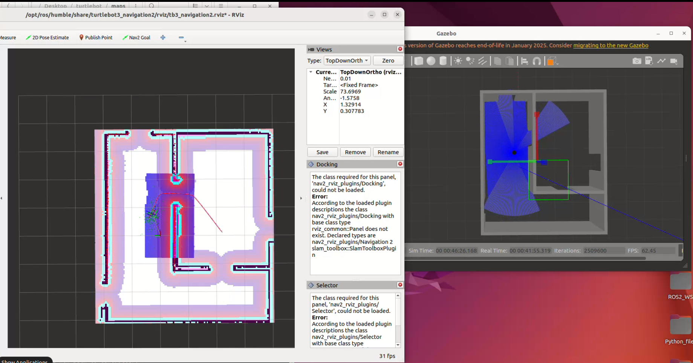

# TurtleBot3 Custom World and Autonomous Navigation

A ROS 2 Humble project based on the ROBOTIS TurtleBot3 simulation package, featuring a custom Gazebo world, two TurtleBot3 robots, environment mapping, and independent autonomous navigation using ROS 2 Nav2.

## Features

- Custom Gazebo world.
- TurtleBot3 Burger simulation.
- Custom environment map.
- Single-robot autonomous navigation using ROS 2 Nav2.
- Two-robot autonomous navigation using ROS 2 Nav2.
- Independent Nav2 configurations for both robots.
- AMCL-based robot localization.
- Combined TF for multi-robot visualization.
- Both robots displayed in a single RViz window.
- Independent navigation goals for each robot.

## Project Demonstrations

### Single-Robot Autonomous Navigation using ROS 2 Nav2



[Watch Single-Robot Navigation Demonstration](media/single_robot_navigation.webm)

### Two-Robot Autonomous Navigation using ROS 2 Nav2


[Watch Two-Robot Navigation Demonstration](media/two_robot_navigation.webm)

## Technologies

- Ubuntu 22.04
- ROS 2 Humble
- Gazebo Classic
- TurtleBot3 Burger
- SLAM Toolbox
- Nav2
- AMCL
- RViz
- Python

## Project Structure

```text
turtlebot3_simulations/
├── media/
│   ├── screenshot_1.png
│   ├── screenshot_2.png
│   ├── single_robot_navigation.webm
│   └── two_robot_navigation.webm
└── turtlebot3_gazebo/
    ├── launch/
    │   ├── my_custom_world.launch.py
    │   ├── my_custom_world_two_robots.launch.py
    │   └── my_custom_world_two_robots_nav.launch.py
    ├── worlds/
    │   └── my_custom_world.world
    ├── models/
    ├── navigation/
    │   ├── maps/
    │   ├── config/
    │   ├── rviz/
    │   └── scripts/
    ├── CMakeLists.txt
    └── package.xml
```

## Installation and Build

Clone the repository into a ROS 2 workspace's `src` directory.

Install the required ROS 2 dependencies, then build:

```bash
cd ~/Desktop/turtlebot

source /opt/ros/humble/setup.bash

colcon build --symlink-install
```

Source the workspace:

```bash
source /opt/ros/humble/setup.bash
source ~/Desktop/turtlebot/install/setup.bash
export TURTLEBOT3_MODEL=burger
```

## Running the Two-Robot Simulation

### 1. Launch Gazebo

In the first terminal:

```bash
source /opt/ros/humble/setup.bash
source ~/Desktop/turtlebot/install/setup.bash
export TURTLEBOT3_MODEL=burger

ros2 launch turtlebot3_gazebo my_custom_world_two_robots.launch.py
```

### 2. Launch Navigation

In the second terminal:

```bash
source /opt/ros/humble/setup.bash
source ~/Desktop/turtlebot/install/setup.bash
export TURTLEBOT3_MODEL=burger

ros2 launch turtlebot3_gazebo my_custom_world_two_robots_nav.launch.py
```

### 3. Combine TF

In the third terminal:

```bash
source /opt/ros/humble/setup.bash
source ~/Desktop/turtlebot/install/setup.bash

python3 ~/Desktop/turtlebot/src/turtlebot3_simulations/turtlebot3_gazebo/navigation/scripts/combine_tf.py
```

This combines the TF data from both robots and publishes it to the global TF topics for RViz visualization.

Keep this terminal running.

### 4. Launch RViz

In another terminal:

```bash
source /opt/ros/humble/setup.bash
source ~/Desktop/turtlebot/install/setup.bash

rviz2 -d ~/Desktop/turtlebot/src/turtlebot3_simulations/turtlebot3_gazebo/navigation/rviz/two_robots_navigation.rviz
```

Both robots can now be visualized in the same RViz window.

### 5. Independent Navigation Goals

Use the **2D Goal Pose** tool in RViz.

Change the goal topic through Tool Properties to select the robot:

- Robot 1: `/TB3_1/goal_pose`
- Robot 2: `/TB3_2/goal_pose`

Select the desired destination on the map. Change the topic to switch between robots.

Both robots can receive separate navigation goals and navigate independently in the shared Gazebo world.

## Original Project

This project extends the open-source simulation package developed by ROBOTIS.

Original repository: https://github.com/ROBOTIS-GIT/turtlebot3_simulations

The original package and its licensing terms remain acknowledged.